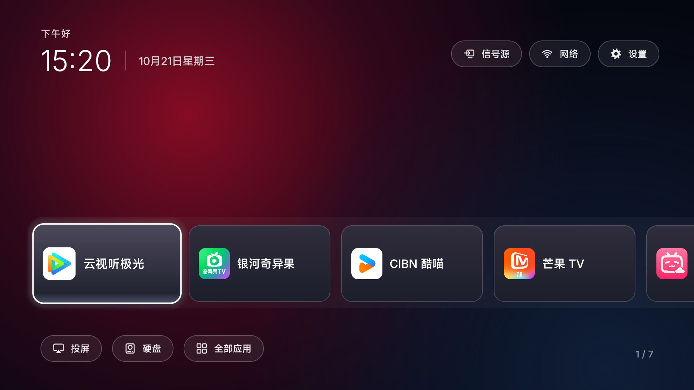

# 简居 TV · 大陆应用版电视桌面

面向中国大陆常用视频应用的简约 Android TV 首页。本仓库基于 [Jimu888/home-tv-cn](https://github.com/Jimu888/home-tv-cn) 完善，原项目基于 [pengchujin/aerial-tv](https://github.com/pengchujin/aerial-tv) 1.16 定制，保留上游 MIT 许可。非官方分支，与小米及视频平台无隶属关系。

> 完善版 `1.16-home.2-local`：新增首页配置与按设备记录的安装恢复。已通过编译和 18 项单元测试，尚未完成真机验收，按预发布版本提供。
>
> [下载 APK 与源码](https://github.com/Johndd1/home-tv-cn/releases/tag/v1.16-home.2-local) · [改动说明](docs/LOCAL-CHANGES.md) · [验证记录](docs/VALIDATION.md)
>
> 本次目录整理以已发布的 `1.16-home.2-local` 提交为基础；另一个本地工作区中的 Android 6 / Home 键修复仍在调试，未并入本仓库。下面截图来自原版，不代表完善版已经在该电视上通过测试。



## 目录结构

```text
.github/       自动检查与协作模板
addons/        扩展说明（当前未提供独立插件）
docs/          改动说明、验证记录与截图
examples/      安装与恢复命令示例
launcher/      Android 桌面应用、Gradle 工程与 Kotlin 测试
tests/         Python 安装恢复测试
themes/        内置主题说明
tools/         设备检查、安装、恢复与辅助工具
```

Android 构建在 `launcher/` 执行；安装、恢复和 Python 测试仍在仓库根目录执行。参考仓库的目录组织不代表本项目具备其清理包名单、去广告或跨品牌兼容能力。详见 [目录说明](docs/STRUCTURE.md)。

## 功能

- 暗红与深蓝背景、统一玻璃卡片、小尺寸原应用图标、遥控器焦点高光。
- 默认排序：**云视听极光 → 银河奇异果 → CIBN 酷喵 → 芒果 TV → 云视听小电视 → Netflix → YouTube**。在“设置 → 首页设置”中，可从已安装应用中选择 1–12 个首页应用并调整顺序；不同渠道版也可直接选入。
- 只替换首页；点击卡片进入电视上已安装的原应用。不会附带、破解或自动安装这些应用。
- 上方提供信号源、网络、控制中心；控制中心内保留系统设置，并提供首页设置与隐藏应用。下方提供投屏、硬盘、全部应用。投屏/硬盘优先识别已安装的小米或 TCL 入口，也可在首页设置中指定其他应用。
- 左右选择应用，上下进入工具栏，确认打开；返回回到第一张卡片，菜单键打开全部应用。
- 未安装应用显示“待安装”。没有广告位、内容推荐流或重复的选中应用大标题。
- 全部应用中长按确认键，可添加到首页、隐藏、查看信息或卸载可移除应用；隐藏项可从控制中心恢复。首页支持红蓝/纯深色背景和标准/高对比焦点边框。

## 兼容性与限制

| 项目 | 当前状态 |
| --- | --- |
| 小米 MiTV-MFTR0，Android 14，HyperOS 3.0.106.0 | 原作者报告已验证原版首页、重启接管、五款国内应用启动及系统入口；本完善版待验收 |
| 投屏、硬盘、蓝牙 | 原版报告验证过入口及硬盘识别；本完善版与全流程播放均待验收 |
| 其他小米、TCL、海信及其他品牌 | 未验证本定制版；上游兼容经验不等于本版通过验证 |
| 系统版本 | 构建最低 Android 5.0；不代表所有 Android 5.0+ 固件可安装或接管首页 |
| Netflix / YouTube | 仅预留入口；需自行安装兼容版本及准备电视自身可用的网络，Netflix 另受设备认证影响 |

上述真机记录来自原版，不代表本次修改已在这些设备上通过验证。快捷入口仍依赖电视已安装的应用；自动识别失败时会提示进入首页设置选择应用，不会安装缺失的投屏或播放器。电视必须允许安装应用或开启 ADB；仅连接同一个 Wi-Fi 并不足以完成改造。安装工具目前支持 macOS/Linux 的 Python 3 与电视主用户（user 0）。

## 安装与恢复

从本仓库 [预发布下载页](https://github.com/Johndd1/home-tv-cn/releases/tag/v1.16-home.2-local) 获取 `home-tv-standard-local.apk` 和源码，或自行构建。原作者的 `v1.16-home.1` 不包含本次修改。包名仍为 `app.orchard.tv`，自行构建默认使用本机 debug key，不能直接覆盖维护者或上游的不同签名版本。工具遇到签名冲突会停止，不会自动卸载或删除数据。

准备 Android platform-tools（`adb`）和 Python 3，电视与电脑连接同一可信局域网，在电视上启用调试并允许电脑连接。在项目根目录执行：

```sh
# 只读检查：设备信息、当前桌面和对应恢复记录路径
TV='<电视IP>' python3 tools/device.py check

# 预览计划，不安装、不改电视设置
TV='<电视IP>' APK_FILE='/absolute/path/home-tv-standard-local.apk' bash tools/install.sh --preview

# 建议先试用：只安装 APK，从电视应用列表打开 Aerial，不授予接管权限
TV='<电视IP>' APK_FILE='/absolute/path/home-tv-standard-local.apk' bash tools/install.sh --launcher-only

# 确认首页、常用应用、信号源等入口可用后，设置桌面接管
TV='<电视IP>' APK_FILE='/absolute/path/home-tv-standard-local.apk' bash tools/install.sh

# 预览/执行恢复，按设备原始记录恢复，不猜测原厂桌面
TV='<电视IP>' bash tools/restore.sh --preview
TV='<电视IP>' bash tools/restore.sh
```

接管前会把原桌面、相关 app-op、写入安全设置权限、无障碍及通知监听状态保存到忽略版本控制的 `local/recovery/`。记录以设备稳定 ID 和型号定位，不仅依赖 IP；重复安装不会覆盖未恢复的原始记录。请保留整个目录，不要公开上传其中的家庭设备信息。

安装先尝试 Android 默认桌面；不能接管时（或显式指定 `--force-guard`）才授予守护服务需要的写入安全设置、悬浮窗及通知监听权限。新安装不会为读取 Wi-Fi 名称额外授予定位，不会启用 `KEEP_ADB`、修改原厂屏保、DNS 或代理，也不会停用/卸载原厂应用。已有安装曾启用的应用内配置不属于系统状态备份，不能借此声称 APK 或应用数据已回滚。

恢复会显式设置记录中的原桌面，并恢复本应用的权限状态；安装后新增的其他无障碍服务和通知监听不会被整份旧列表覆盖。没有记录、记录损坏、设备不符或恢复失败时会停止并保留记录，不会打印“恢复成功”。它恢复的是此次安装工具管理的系统状态，不是整机或应用数据备份，也不能还原旧安装脚本曾经做过、却未记录的修改。

若当前已由简居 TV 接管且没有恢复记录，请先在电视设置里选回原桌面，再运行新工具；或在已核实原桌面组件后使用 `--original-home 包名/Activity`。不要猜一个品牌通用包名代替设备实际状态。

仅当本应用在记录前不存在时，`restore.sh --uninstall` 才允许卸载并删除它的数据；普通恢复会保留 APK。若先用了 `--launcher-only`，接管前它就已经存在，所以恢复不会自动删除该试用安装。

受限制的 TCL 固件不会被脚本自动绕过。`guard` 变体需要自行构建，在明确设备兼容的前提下使用 `tools/install.sh guard`；本版没有 guard 真机验收，也不承诺其他品牌都能安装。每台设备仍需验证按 Home、重启、待机唤醒、投屏、媒体播放及恢复结果。

## 广告处理的边界

本首页没有广告。应用内的开屏、片头、暂停广告仍由视频平台控制，本项目不是全机广告拦截器。示例小米电视上另行手动关闭了应用商店/小米商城通知和匿名设备标识符，开启了观影免打扰；这些是设备设置，**不会随 APK 自动应用到别人的电视**。关闭广告标识符也不等于减少广告数量。

## 构建

需要 JDK 17、Android SDK 36，并设置 `JAVA_HOME` 与 `ANDROID_HOME`：

```sh
(cd launcher && ./gradlew assembleStandardRelease lintStandardRelease)
```

输出位于 `launcher/app/build/outputs/apk/standard/release/`。本仓库当前预发布 APK 使用本地 Android debug key 签名，签名密钥不提交。本版适合试用，长期维护建议配置并备份自己的发布签名；不同签名的 APK 不能直接覆盖安装。

签名配置位于忽略版本控制的 `local/signing.properties`，字段为 `storeFile`（相对于 `local/`）、`storePassword`、`keyAlias`、`keyPassword`。不要分享该文件和密钥。

上游保留的 `guard` 构建供拒绝 HOME 声明的固件研究使用，本次未提供真机验收；新安装工具不会自动切换构建或走第三方安装通道。

## 开发验证

```sh
python3 -m unittest discover -s tests -v
bash -n tools/install.sh tools/restore.sh
(cd launcher && ./gradlew testStandardReleaseUnitTest assembleStandardRelease lintStandardRelease)
```

Python 测试使用模拟设备覆盖重复安装、权限恢复、HOME 恢复失败、无记录/损坏记录拒绝执行及其他服务的保留；Kotlin 测试验证首页应用配置、排序和数量边界。这些检查不能代替电视真机验收。具体改动与来源见 [本地改动说明](docs/LOCAL-CHANGES.md)。

## 来源与许可

上游基线：`pengchujin/aerial-tv` 提交 `5a91b87852f2a66139d207ec2942f2d6964726f9`。感谢原作者提供桌面接管、系统入口及 UI 基础。

代码遵循 [MIT License](LICENSE)，字体遵循 [OFL](FONT-LICENSE-OFL.txt)。应用名称、图标及商标归各自权利人所有。截图中的应用图标由电视上已安装应用提供，本仓库不分发对应商业应用 APK。

本地完善参考 [Gathin23/cleanyourtv](https://github.com/Gathin23/cleanyourtv) 的按设备记录恢复、可配置首页和独立应用库思路；没有导入其清理包名单，也没有继承其设备兼容性结论。参考范围及 MIT 许可见 [THIRD-PARTY-NOTICES.md](THIRD-PARTY-NOTICES.md)。
